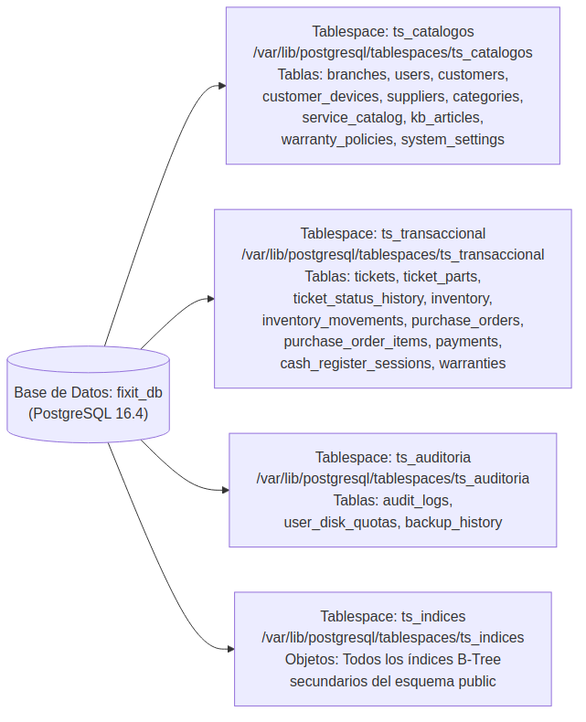
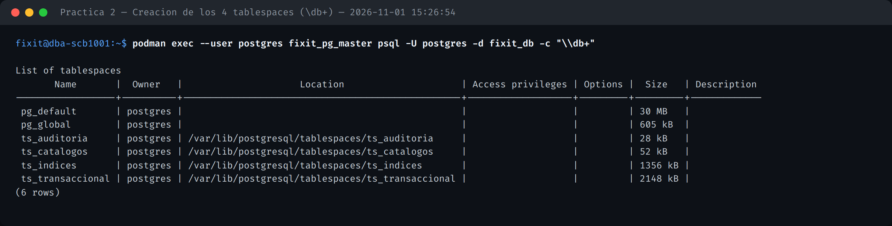
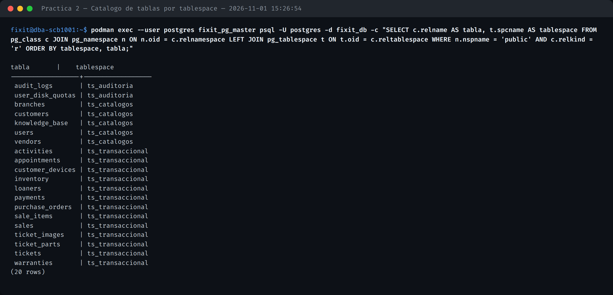
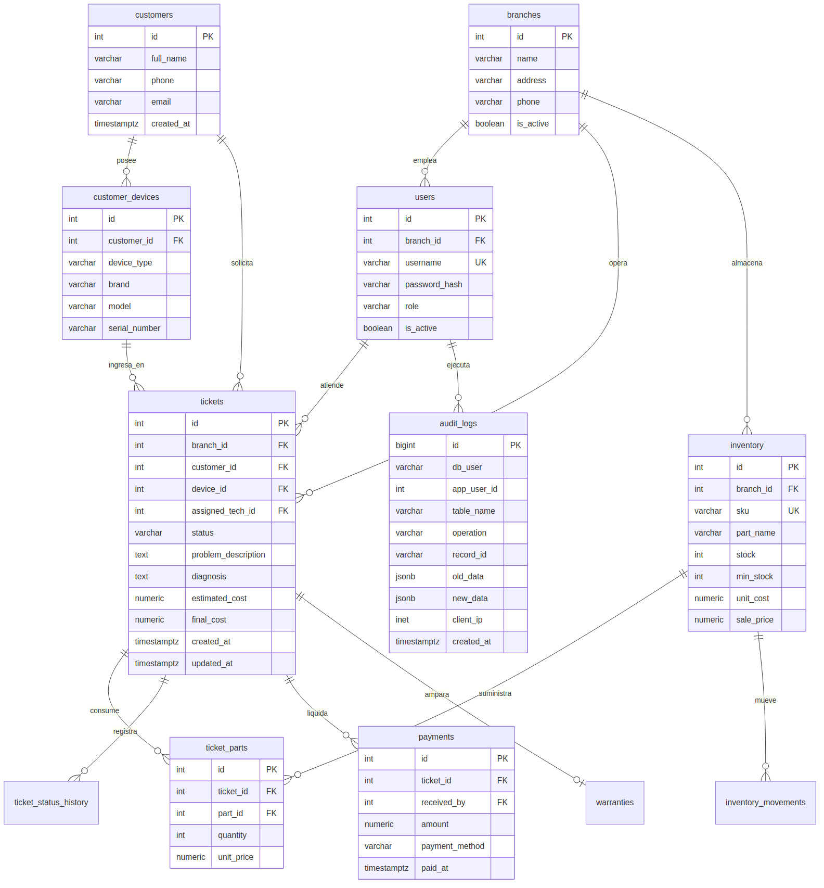
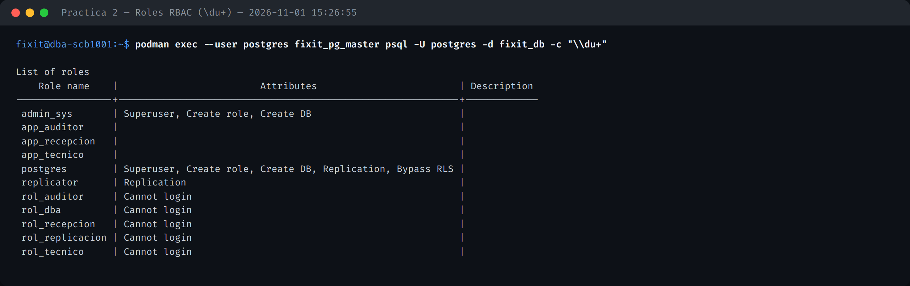
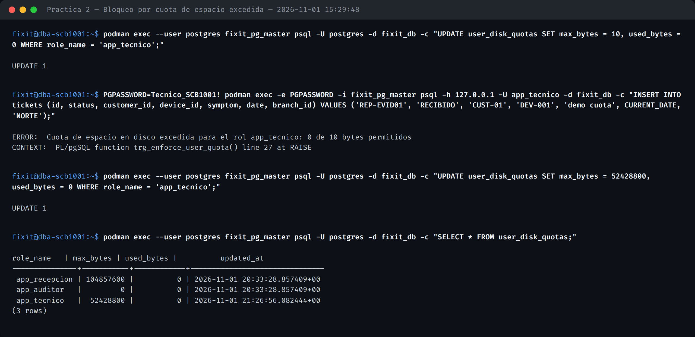

# DICCIONARIO_DATOS.md — SCB-1001

**Unidad 3** (Configuración y administración del espacio en disco) · **Práctica 2**

## 1. Distribución física en tablespaces

| Tablespace | Contenido | Ruta física (contenedor) |
| :--- | :--- | :--- |
| `ts_catalogos` | `branches`, `users`, `customers`, `vendors`, `knowledge_base` | `/var/lib/postgresql/tablespaces/ts_catalogos` |
| `ts_transaccional` | `inventory`, `tickets`, `ticket_parts`, `payments`, `warranties`, `purchase_orders`, `customer_devices`, `loaners`, `appointments`, `activities`, `ticket_images`, `sales`, `sale_items` | `/var/lib/postgresql/tablespaces/ts_transaccional` |
| `ts_auditoria` | `audit_logs`, `user_disk_quotas` | `/var/lib/postgresql/tablespaces/ts_auditoria` |
| `ts_indices` | Todos los índices B-Tree (PK, UNIQUE y secundarios) | `/var/lib/postgresql/tablespaces/ts_indices` |

## 2. Modelo relacional (19 tablas, normalizado 3FN)

El esquema completo con tipos, PK/FK y restricciones está definido en [`src/sql/02_schema.sql`](src/sql/02_schema.sql), migrado 1:1 desde el `database.py` original de SQLite. Tablas clave:

| Tabla | PK | FK principales | Notas de tipo |
| :--- | :--- | :--- | :--- |
| `branches` | `id` VARCHAR(20) | — | `tax_rate` NUMERIC(5,4) |
| `users` | `id` IDENTITY | `branch_id` → `branches` | `username` UNIQUE |
| `customers` | `id` VARCHAR(20) | — | |
| `inventory` | `id` VARCHAR(30) | `branch_id` → `branches` | `specs` JSONB, `stock` CHECK ≥ 0 |
| `tickets` | `id` VARCHAR(20) | `customer_id`, `device_id`, `branch_id` | `date` DATE |
| `payments` | `id` IDENTITY | `ticket_id` → `tickets` | `amount` CHECK > 0 |
| `audit_logs` | `id` IDENTITY | `branch_id` → `branches` | `old_data`/`new_data` JSONB (T-10) |
| `user_disk_quotas` | `role_name` VARCHAR(50) | — | `max_bytes`/`used_bytes` BIGINT |

## 3. Roles RBAC

| Rol | Login | Privilegios |
| :--- | :--- | :--- |
| `rol_dba` | `admin_sys` | SUPERUSER, control total |
| `rol_tecnico` | `app_tecnico` | SELECT catálogos; INSERT/UPDATE tickets, ticket_parts; sin DELETE, sin `payments` |
| `rol_recepcion` | `app_recepcion` | SELECT/INSERT/UPDATE customers, devices, tickets; SELECT/INSERT payments |
| `rol_auditor` | `app_auditor` | SELECT exclusivo `audit_logs` + `pg_read_all_stats` |
| `rol_replicacion` | `replicator` | `REPLICATION LOGIN` |

## 4. Cuotas de espacio por rol

El trigger `trg_enforce_user_quota()` ([`src/sql/03_roles_and_quotas.sh`](src/sql/03_roles_and_quotas.sh)) aborta cualquier `INSERT` que exceda la cuota asignada en `user_disk_quotas`, usando `session_user` (no `current_user`, por ser `SECURITY DEFINER`) para identificar siempre al rol conectado.

| Rol | Cuota máxima |
| :--- | :---: |
| `app_tecnico` | 50 MB (52,428,800 bytes) |
| `app_recepcion` | 100 MB (104,857,600 bytes) |
| `app_auditor` | 0 (solo lectura) |
