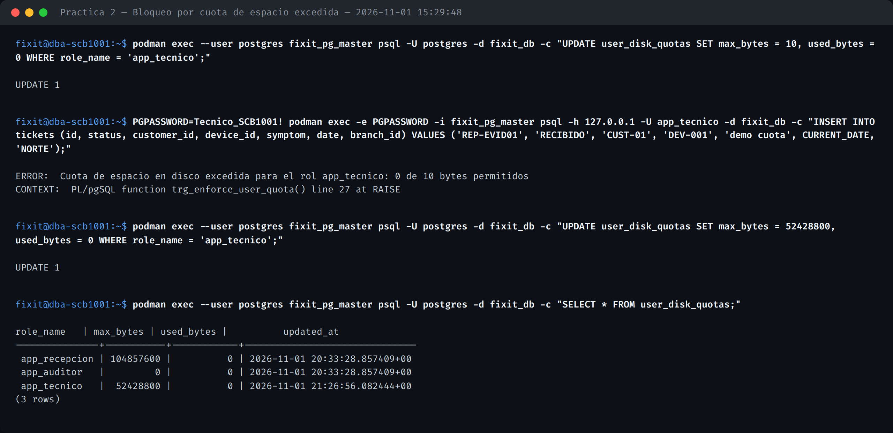
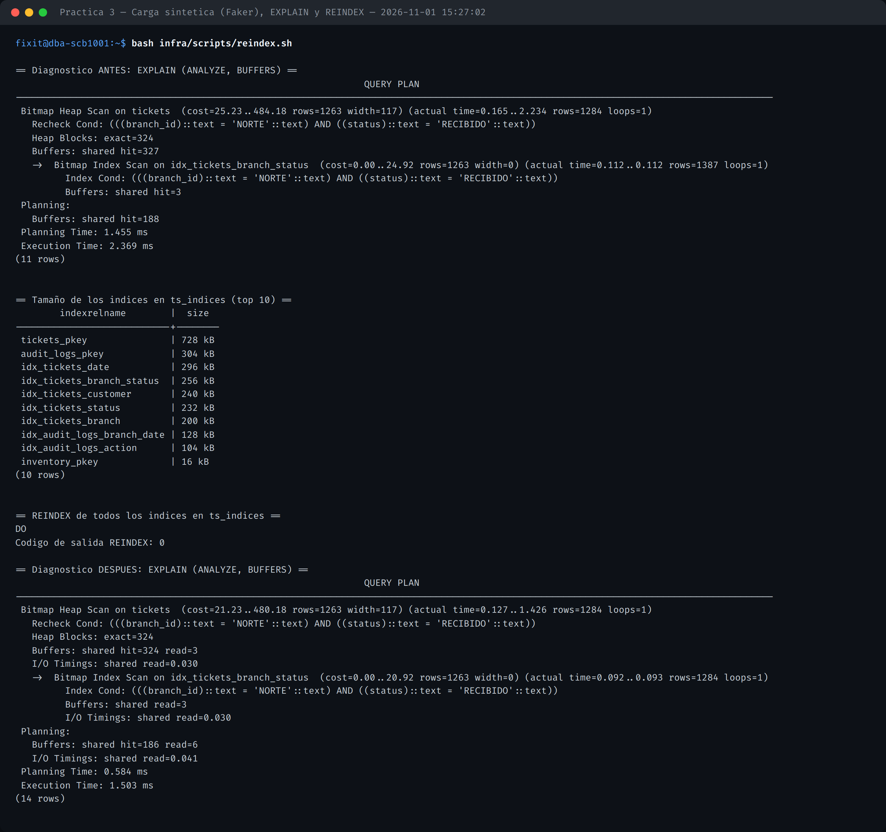
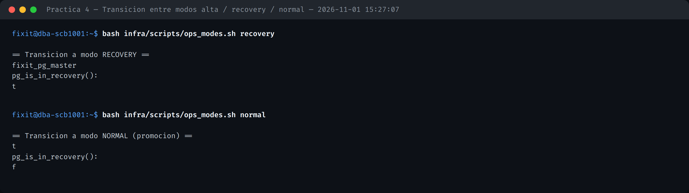
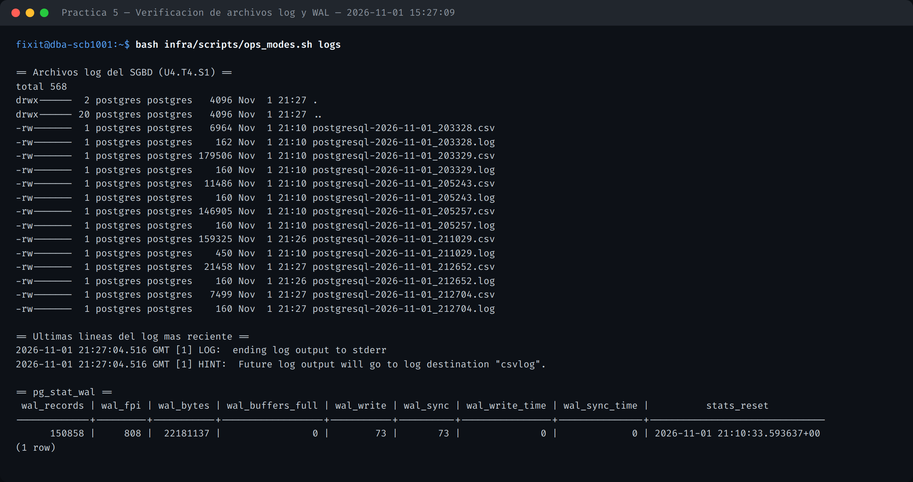

# MANUAL_ADMINISTRACION.md — SCB-1001

**Unidad 3** (Espacio en disco, cuotas, roles) · **Unidad 4** (Operación y mantenimiento) · **Prácticas 2, 3, 4 y 5**

## 1. Administración de espacio en disco y cuotas de usuario

El trigger `trg_enforce_user_quota()` audita el espacio atribuido a cada rol en `user_disk_quotas` y aborta el `INSERT` cuando se excede el límite, devolviendo literalmente `ERROR: Cuota de espacio en disco excedida`.

## 2. Índices, reorganización y reconstrucción

`src/sql/04_indexes.sql` cubre los índices de FK/filtro que no quedaron en `02_schema.sql`. `infra/scripts/reindex.sh` diagnostica con `EXPLAIN (ANALYZE, BUFFERS)`, reconstruye cada índice en `ts_indices` vía `REINDEX INDEX` (Postgres no tiene `REINDEX TABLESPACE`) y vuelve a medir.

`src/data_generator/seed_workload.py` (Faker 30.1.0) inyecta carga sintética en segundos para ejercitar estos índices bajo volumen real.

## 3. Modos de operación: alta, baja y recovery

`infra/scripts/ops_modes.sh` controla la transición entre modos:

- **recovery**: crea `standby.signal` y reinicia el contenedor para forzar un `pg_is_in_recovery() = true` sostenido (no hay un segundo nodo primario aún en este punto del ciclo; se usa el propio nodo como standby de sí mismo).
- **normal**: promueve con `SELECT pg_promote();`, volviendo a modo lectura-escritura sin downtime de reinicio.

## 4. Archivos log y WAL

`ops_modes.sh logs` lista `pg_log/*.csv`, muestra las últimas líneas del log activo y consulta `pg_stat_wal`.

## 5. Configuración relevante (`infra/config/postgresql.conf`)

| Parámetro | Valor | Propósito |
| :--- | :--- | :--- |
| `wal_level` | `replica` | Habilita Streaming Replication y PITR |
| `archive_mode` / `archive_command` | `on` / copia a `wal_archive` | Respaldo continuo de WAL |
| `logging_collector` | `on` | Archivos log en `pg_log/` (csvlog) |
| `shared_preload_libraries` | `pg_stat_statements` | Monitoreo de consultas (Unidad 6) |
| `max_wal_senders` / `max_replication_slots` | 10 / 10 | Soporte de réplicas físicas |
