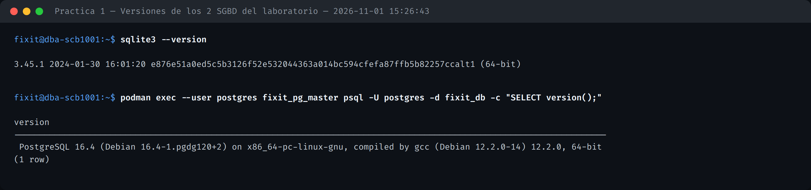
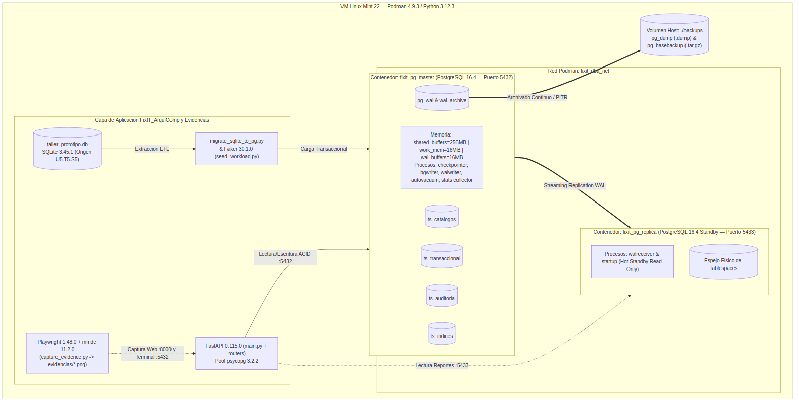
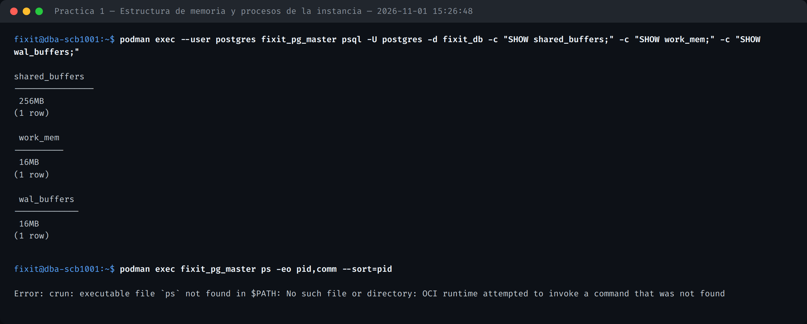
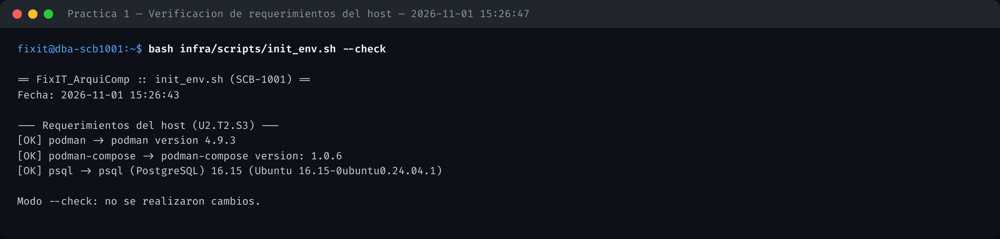
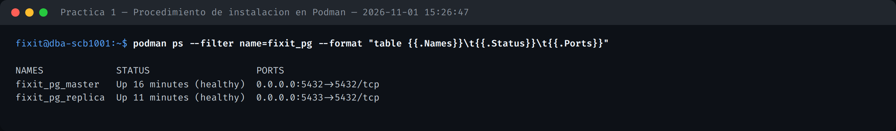
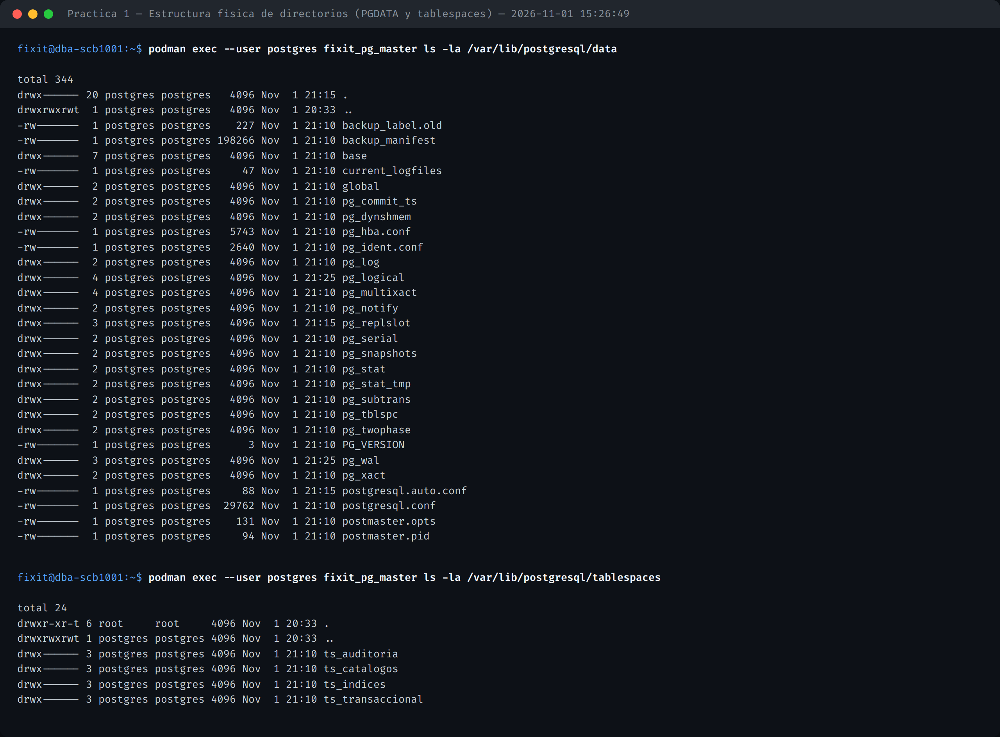
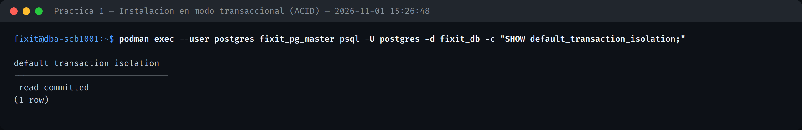
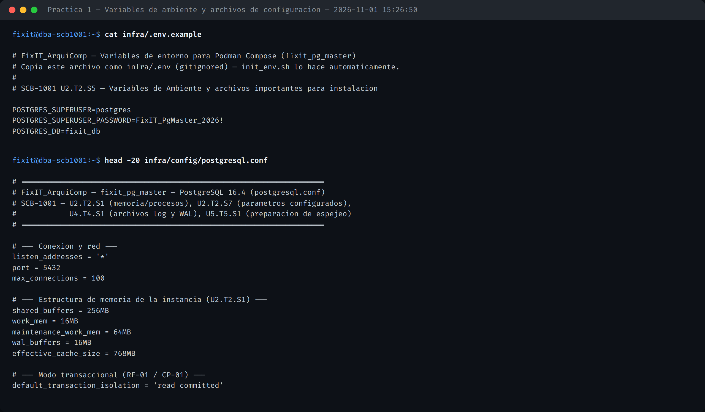
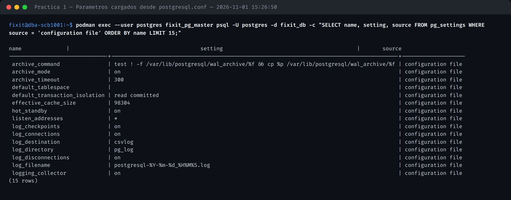
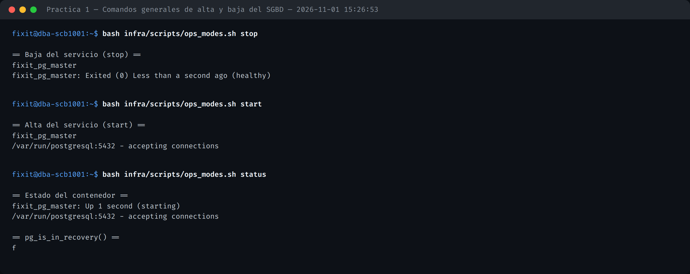

# MANUAL_INSTALACION.md — SCB-1001

**Unidad 1** (Perspectiva de la administración de bases de datos) · **Unidad 2** (Arquitectura e instalación del SGBD) · **Práctica 1**

## 1. Funciones del Administrador de Base de Datos (DBA)

| Función del DBA | Evidencia en este proyecto |
| :--- | :--- |
| Instalar y configurar el SGBD | `infra/scripts/init_env.sh`, `infra/compose.yaml` |
| Definir espacio de almacenamiento (tablespaces) | `src/sql/01_tablespaces.sql` |
| Administrar seguridad y accesos (roles, cuotas) | `src/sql/03_roles_and_quotas.sql` |
| Garantizar disponibilidad (espejeo/réplica) | `infra/scripts/setup_replication.sh` |
| Planificar respaldo y recuperación | `infra/scripts/backup_job.sh`, `restore_pitr.sh` |
| Monitorear rendimiento y auditar | `src/sql/05_audit_and_monitoring.sql`, `monitor_resources.sh` |

## 2. Comparativa de SGBD evaluados

| Criterio | Peso | PostgreSQL 16.4 | MySQL 8.0.39 | SQLite 3.45.1 |
| :--- | :---: | :---: | :---: | :---: |
| Cobertura del temario (tablespaces, roles, WAL/PITR, réplica) | 35% | 10.0 | 8.0 | 2.0 |
| Monitoreo y auditoría sin licencia | 20% | 9.5 | 7.5 | 3.0 |
| Concurrencia transaccional (MVCC, `FOR UPDATE`) | 20% | 10.0 | 9.0 | 4.0 |
| Compatibilidad con el esquema existente | 15% | 9.0 | 8.5 | 10.0 |
| Ejecución rootless en contenedores | 10% | 10.0 | 9.0 | 10.0 |
| **Total ponderado** | 100% | **9.75** | 8.28 | 4.60 |

**Decisión:** PostgreSQL 16.4 como motor transaccional principal (maestro-réplica), manteniendo SQLite 3.45.1 como segundo SGBD del laboratorio y origen real de la migración.



## 3. Arquitectura de memoria, procesos y despliegue



fixit_pg_master corre en Podman 4.9.3 rootless, con memoria configurada en `infra/config/postgresql.conf` (`shared_buffers=256MB`, `work_mem=16MB`, `wal_buffers=16MB`) y los procesos estándar de la instancia (checkpointer, bgwriter, walwriter, autovacuum, stats collector).



## 4. Requerimientos del host

`infra/scripts/init_env.sh --check` valida Podman, podman-compose y psql antes de aprovisionar.



## 5. Procedimiento de instalación

`infra/scripts/init_env.sh` crea la estructura física de volúmenes (uid/gid 999 "postgres"), copia `infra/.env.example` → `infra/.env`, y levanta el contenedor vía `podman-compose`.



## 6. Estructura física de directorios

`PGDATA` y los 4 tablespaces residen en volúmenes bind-mount independientes (`infra/volumes/pgdata`, `infra/volumes/tablespaces/ts_*`), propiedad del uid 999 dentro del contenedor.



## 7. Instalación en modo transaccional (ACID)

RF-01 exige que la instancia opere en modo transaccional con aislamiento `read committed` (verificable también vía `python3 -c "import database; print(database.check_engine())"` → `PostgreSQL 16.4`).



## 8. Variables de ambiente y archivos de configuración

Parámetros de conexión en `.env.example` (raíz, para la app) e `infra/.env.example` (para Podman Compose); configuración del motor en `infra/config/postgresql.conf` y `infra/config/pg_hba.conf`.



## 9. Parámetros efectivos cargados desde postgresql.conf

```sql
SELECT name, setting, source FROM pg_settings WHERE source = 'configuration file';
```



## 10. Comandos generales de alta y baja

`infra/scripts/ops_modes.sh [start|stop|status|recovery|normal|logs]` controla el ciclo de vida del contenedor.


