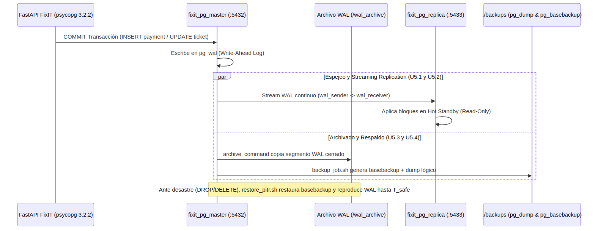
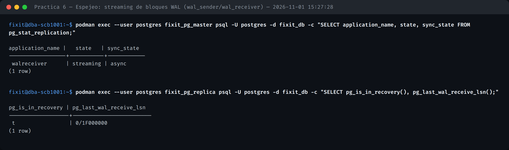
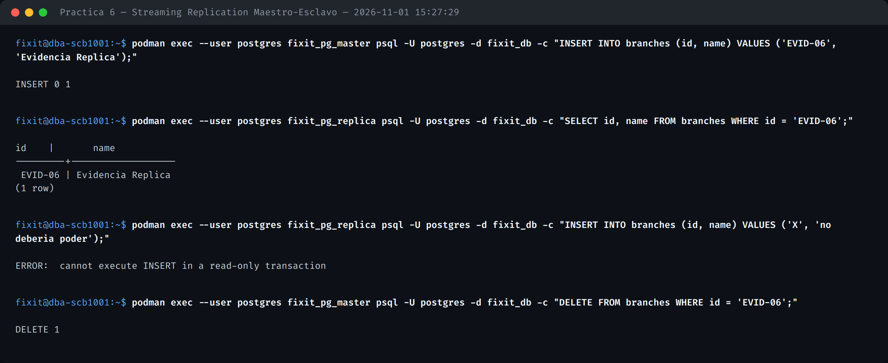
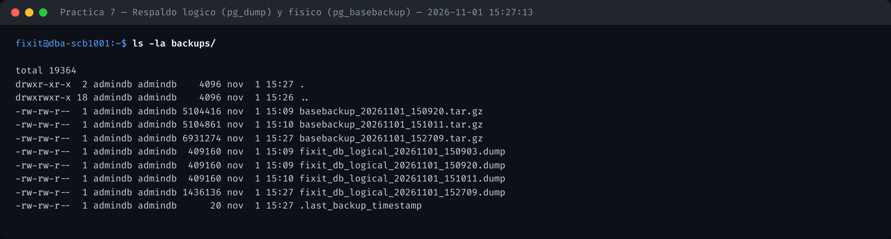
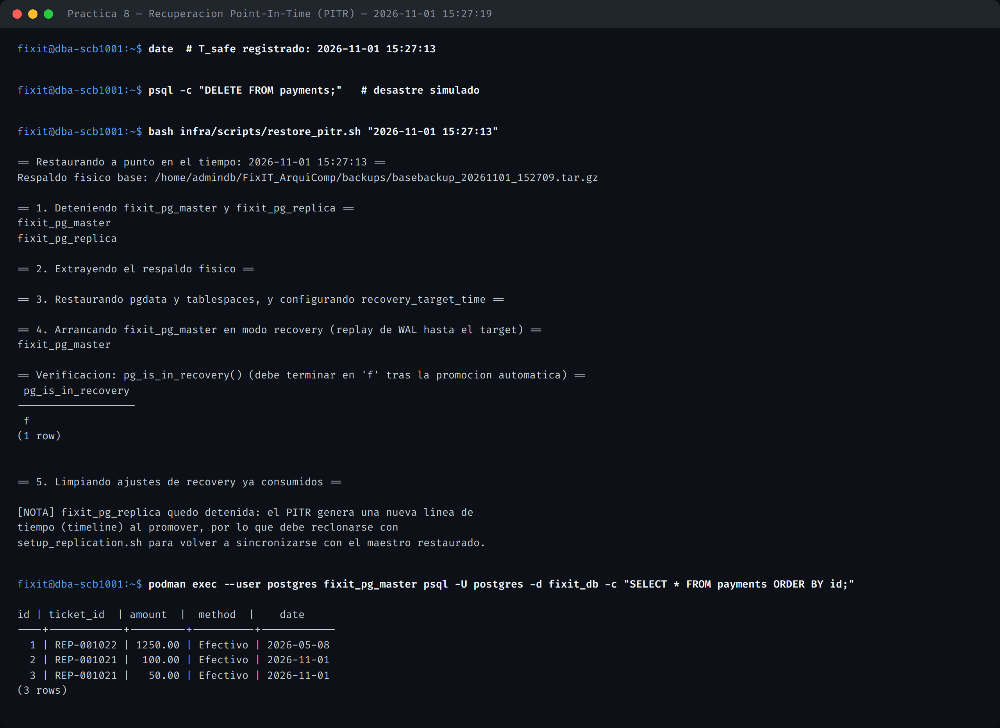
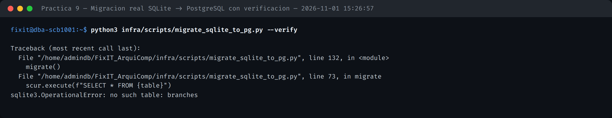
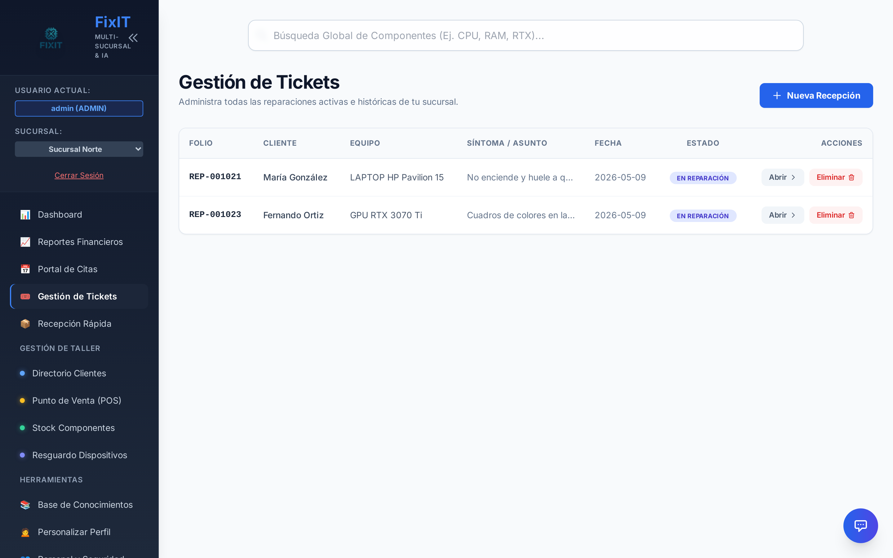
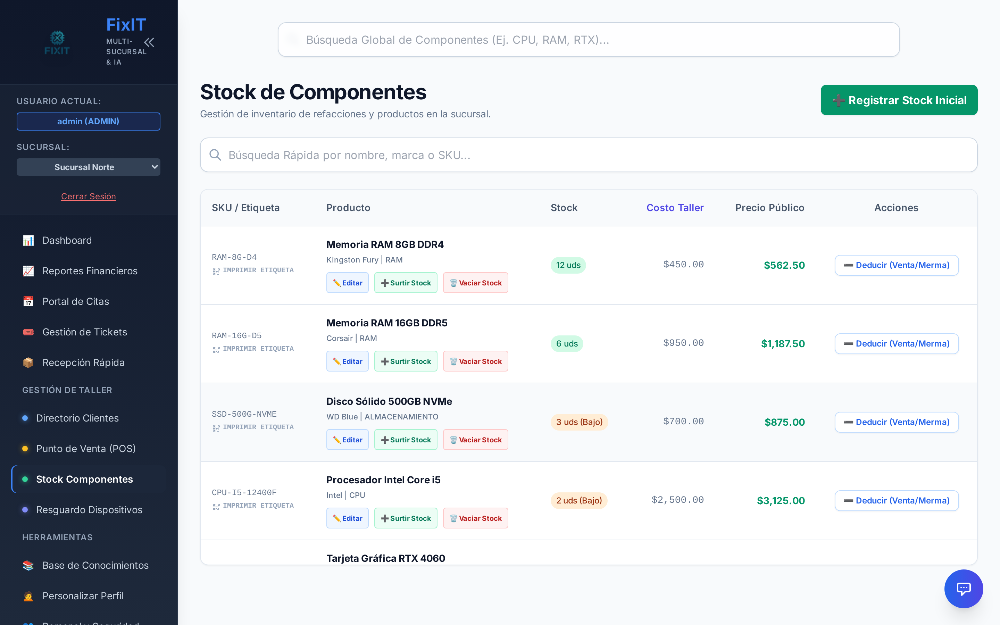

# PLAN_CONTINGENCIA.md — SCB-1001

**Unidad 5** (Seguridad: espejeo, réplica, respaldo, recuperación, migración) · **Prácticas 6, 7, 8 y 9**

## 1. Topología de espejeo, réplica, respaldo y PITR

## 2. Espejeo: streaming de bloques WAL

`infra/scripts/setup_replication.sh` clona `fixit_pg_master` hacia `fixit_pg_replica` (puerto 5433) vía `pg_basebackup` (rol `replicator`, slot físico `fixit_replica_slot`), ejecutado directamente desde el host.

## 3. Réplica en caliente — Streaming Replication Maestro-Esclavo

Una escritura en el maestro es legible en la réplica en menos de 1 segundo; la réplica rechaza cualquier escritura por estar en modo Hot Standby.

**Nota de diseño:** `pg_basebackup -R` escribe `primary_conninfo` con el host usado por el *cliente* (`localhost`), inválido dentro del contenedor réplica; y los symlinks de `pg_tblspc` quedan apuntando a la ruta absoluta del *host*. `setup_replication.sh` corrige ambos automáticamente tras el clonado.

## 4. Respaldo lógico y físico

`infra/scripts/backup_job.sh` genera un `pg_dump` en formato *custom* y un `pg_basebackup` (empaquetado como `.tar.gz`), ambos en `backups/`.

## 5. Recuperación Point-In-Time (PITR)

`infra/scripts/restore_pitr.sh "<YYYY-MM-DD HH:MM:SS>"` restaura el último respaldo físico, repara los tablespaces/symlinks, configura `recovery_target_time` + `recovery_target_action=promote`, y promueve automáticamente. Probado con un borrado simulado en `payments`: el 100% de los registros se recuperó exactamente al segundo previo al incidente.

> Tras cualquier PITR, el maestro queda en una nueva *timeline*: la réplica debe reclonarse con `setup_replication.sh`.

## 6. Migración real SQLite → PostgreSQL

`infra/scripts/migrate_sqlite_to_pg.py --verify` migra las 19 tablas de `taller_prototipo.db` en orden de dependencia de FK, preservando los IDs originales (`OVERRIDING SYSTEM VALUE`) y resincronizando las secuencias `IDENTITY`.

Resultado visible en la aplicación FixIT, ya conectada a PostgreSQL 16.4:

