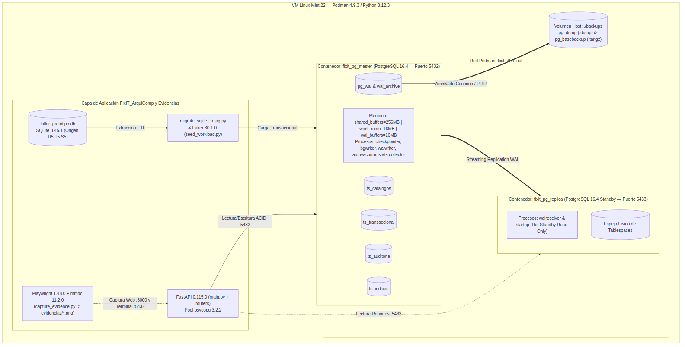
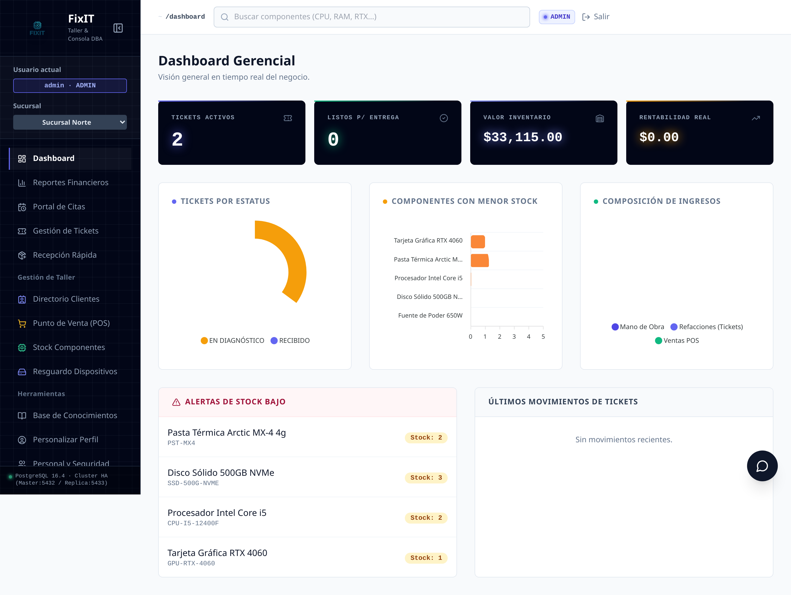

# 🛠️ FixIT Enterprise DBA — SCB-1001


**FixIT** es un sistema de gestión integral para talleres de reparación de hardware (tickets, inventario, punto de venta, clientes). Este repositorio documenta su evolución desde una arquitectura monolítica sobre **SQLite 3.45.1** hacia un **clúster transaccional distribuido en PostgreSQL 16.4**, contenedorizado con **Podman 4.9.3**, cubriendo el 100% del temario oficial **Administración de Base de Datos (SCB-1001)** del TecNM.

Toda operación de DBA descrita en este repositorio (instalación, tablespaces, roles y cuotas, modos de operación, índices, replicación, respaldo/recuperación PITR, migración, auditoría y monitoreo) se verificó con comandos reales ejecutados contra el clúster y quedó documentada con evidencia visual automatizada.





---

## Índice

1. [Características principales](#características-principales)
2. [Tecnologías y versiones](#tecnologías-y-versiones)
3. [Requisitos previos](#requisitos-previos)
4. [Requisitos de hardware y sistema operativo](#requisitos-de-hardware-y-sistema-operativo)
5. [Clonación del repositorio](#1-clonación-del-repositorio-y-selección-de-la-rama)
6. [Variables de entorno](#2-configuración-de-variables-de-entorno)
7. [Dependencias de Python](#3-instalación-de-dependencias-de-python)
8. [PostgreSQL 16.4 vía Podman](#4-instalación-y-configuración-de-postgresql-mediante-podman)
9. [Migración SQLite → PostgreSQL](#5-migración-de-sqlite-a-postgresql)
10. [Réplica (opcional)](#6-configuración-opcional-de-la-réplica)
11. [Ejecutar la aplicación](#7-ejecución-de-la-aplicación-fastapi)
12. [URLs, puertos y credenciales](#urls-puertos-y-credenciales-de-laboratorio)
13. [Administrar los contenedores](#administrar-los-contenedores)
14. [Pruebas](#ejecución-de-pruebas)
15. [Solución de problemas](#solución-de-problemas-frecuentes)
16. [Estructura del proyecto](#estructura-importante-del-proyecto)
17. [Advertencias de seguridad](#advertencias-de-seguridad)
18. [Manuales del proyecto](#manuales-del-proyecto)
19. [Análisis de la rama](#análisis-de-la-rama-featdba-postgres-scb1001)

---

## Características principales

- 📱 Gestión de tickets de reparación por estados (Recibido → Entregado y Pagado)
- 🛒 Punto de venta (POS) integrado con el inventario
- 📦 Control de inventario con especificaciones en JSONB
- 👥 CRM de clientes y dispositivos
- 🔐 RBAC multi-sucursal con cuotas de espacio por rol a nivel de PostgreSQL
- 🔔 Notificaciones SMS vía Twilio (opcional, simuladas en consola si no se configura)
- 📊 Auditoría dinámica activable/desactivable con trazas JSONB antes/después
- 🗄️ Clúster PostgreSQL maestro-réplica (Streaming Replication) con respaldo lógico/físico y recuperación Point-In-Time (PITR)

## Tecnologías y versiones

Versiones **tal como están fijadas en `requirements.txt`** y verificadas en este entorno:

| Componente | Tecnología | Versión |
| :--- | :--- | :--- |
| SGBD principal | PostgreSQL (maestro + réplica) | 16.4 (`postgres:16.4-bookworm`) |
| SGBD de origen (migración) | SQLite | 3.45.1 |
| Orquestación de contenedores | Podman / podman-compose | 4.9.3 / 1.0.6 |
| Lenguaje | Python | 3.12.3 |
| Backend | FastAPI | 0.110.0 |
| Servidor ASGI | Uvicorn | 0.29.0 |
| Conector PostgreSQL | psycopg | 3.2.2 (`psycopg[binary,pool]`) |
| Plantillas | Jinja2 | 3.1.3 |
| Autenticación | PyJWT / bcrypt | 2.8.0 / 4.1.2 |
| Carga sintética de pruebas | Faker | 30.1.0 |
| Evidencia visual | Playwright / mermaid-cli (`mmdc`) | 1.48.0 / 11.x |
| Pruebas | pytest | 8.3.3 |

> `requirements.txt` está codificado en **UTF-16LE con BOM** (heredado del proyecto original). Si lo editas, consérvalo así o `pip install` podría no leerlo correctamente en algunos sistemas.

## Requisitos previos

Herramientas que deben estar instaladas **en el host** (no solo dentro de los contenedores):

| Herramienta | Uso | Paquete en Linux Mint / Ubuntu / Debian |
| :--- | :--- | :--- |
| **Python 3.12+** | Ejecutar FastAPI y los scripts de migración/carga | `python3 python3-venv python3-pip` |
| **Podman 4.9+** | Orquestar `fixit_pg_master` y `fixit_pg_replica` | `podman` |
| **podman-compose 1.0+** | Levantar `infra/compose.yaml` | `podman-compose` |
| **Cliente de PostgreSQL 16** (`psql`, `pg_dump`, `pg_basebackup`, `pg_restore`, `pg_isready`) | Los scripts de respaldo, PITR y réplica se ejecutan **desde el host**, conectando por red al puerto publicado del contenedor | `postgresql-client-16` |
| **Git 2.x** | Clonar y versionar el repositorio | `git` |
| **Node.js 18+ y npm** | Solo si vas a **regenerar** los diagramas de `evidencias/diagramas/` con `capture_evidence.py` | `nodejs npm`, luego `npm install -g @mermaid-js/mermaid-cli` |

No se requiere instalar PostgreSQL directamente en el host: el servidor corre exclusivamente dentro de los contenedores Podman.

## Requisitos de hardware y sistema operativo

Determinados a partir del entorno real usado para desarrollar y probar este proyecto (Linux Mint 22.3 "Zena", 2 vCPU, 3.8 GiB RAM):

| Recurso | Mínimo observado | Recomendado |
| :--- | :--- | :--- |
| CPU | 2 núcleos | 2+ núcleos |
| RAM | ~2.1 GiB en uso con maestro + réplica + app corriendo | 4 GiB mínimo, 8 GiB cómodo (holgura para `seed_workload.py`, pytest y Playwright simultáneos) |
| Disco | ~1.4 GiB para los volúmenes de datos del clúster (crece con los respaldos en `backups/`) | 10 GiB libres como margen de trabajo |
| Sistema operativo | Linux Mint 22.3 (compatible con Ubuntu 24.04 / Debian 12) | Cualquier distro Linux con soporte de Podman rootless (subuid/subgid configurados) |

> El proyecto depende de **Podman rootless**: tu usuario necesita un rango de subuid/subgid asignado (`/etc/subuid`, `/etc/subgid`), que `apt install podman` configura automáticamente en Mint/Ubuntu.

---

## 1. Clonación del repositorio y selección de la rama

```bash
git clone https://github.com/GreenEnGit/FixIT_ArquiComp.git
cd FixIT_ArquiComp
git checkout feat/dba-postgres-scb1001
```

> La rama `master` corresponde a la versión original sobre SQLite. **Toda la infraestructura PostgreSQL descrita en este README vive en `feat/dba-postgres-scb1001`** (ver el [análisis de la rama](#análisis-de-la-rama-featdba-postgres-scb1001) al final de este documento).

## 2. Configuración de variables de entorno

Hay **dos** archivos `.env`, con propósitos distintos:

```bash
# Variables de la app FastAPI (SECRET_KEY, conexión a Postgres, Gemini/Twilio opcionales)
cp .env.example .env

# Variables de Podman Compose para fixit_pg_master (usuario/clave superusuario, nombre de BD)
cp infra/.env.example infra/.env
```

Ambos pasos de `cp` de arriba son opcionales: **`infra/scripts/init_env.sh` crea `infra/.env` y `.env` automáticamente si no existen**, y genera una contraseña aleatoria única para cada variable que haya quedado en `CHANGE_ME` — nunca se usa un valor publicado en el repositorio. También sincroniza `PGPASSWORD` (raíz) con `ADMIN_SYS_PASSWORD` (`infra/.env`) para que ambos archivos queden consistentes sin pasos manuales.

Variables relevantes de `.env` (raíz):

| Variable | `.env.example` | Descripción |
| :--- | :--- | :--- |
| `SECRET_KEY` | *(vacío)* | Firma de tokens JWT. Genera una con `python -c "import secrets; print(secrets.token_hex(32))"`. Si se deja vacía, la app usa una clave de desarrollo con una advertencia en el log. |
| `PGHOST` | `localhost` | Host de `fixit_pg_master` |
| `PGPORT` | `5432` | Puerto publicado del maestro |
| `PGDATABASE` | `fixit_db` | Base de datos de la aplicación |
| `PGUSER` | `admin_sys` | Rol con el que la app FastAPI se conecta (ver [credenciales](#urls-puertos-y-credenciales-de-laboratorio)) |
| `PGPASSWORD` | `CHANGE_ME` | Generada automáticamente por `init_env.sh` (sincronizada con `ADMIN_SYS_PASSWORD` de `infra/.env`). **Nunca pongas la contraseña real en un archivo versionado.** |
| `GEMINI_API_KEY`, `TWILIO_*` | *(vacíos)* | Opcionales: si se dejan vacíos, el chatbot usa modo simulación y las notificaciones SMS se imprimen en consola |

> ⚠️ Ninguna contraseña real debe aparecer jamás en `.env.example`, `infra/.env.example` ni en ningún archivo que se vaya a hacer `git commit`. Los valores operativos viven únicamente en `.env` e `infra/.env` (ambos en `.gitignore`).

## 3. Instalación de dependencias de Python

```bash
python3 -m venv .venv
source .venv/bin/activate
pip install -r requirements.txt
```

Esto instala FastAPI, psycopg3, Playwright, pytest, Faker y el resto de dependencias fijadas en `requirements.txt`. Para las capturas automatizadas con Playwright, instala además el navegador:

```bash
playwright install chromium
```

## 4. Instalación y configuración de PostgreSQL mediante Podman

```bash
bash infra/scripts/init_env.sh
```

Este script (verificable primero en modo lectura con `bash infra/scripts/init_env.sh --check`):

1. Verifica que `podman`, `podman-compose` y `psql` estén instalados.
2. Crea la estructura de volúmenes (`infra/volumes/pgdata`, `infra/volumes/tablespaces/ts_*`) con permisos `0700` y propietario uid/gid `999` (usuario `postgres` dentro del contenedor).
3. Crea `infra/.env` desde `infra/.env.example` si no existe, **genera una contraseña aleatoria única para cada variable en `CHANGE_ME`** (superusuario y los 5 roles RBAC) y sincroniza `PGPASSWORD` del `.env` raíz con `ADMIN_SYS_PASSWORD`.
4. Levanta `fixit_pg_master` vía `podman-compose -f infra/compose.yaml up -d`, que a su vez ejecuta en orden los scripts de `src/sql/` (`01_tablespaces.sql` → `02_schema.sql` → `03_roles_and_quotas.sh` → `04_indexes.sql` → `05_audit_and_monitoring.sql`) como *init scripts* de PostgreSQL — solo en el primer arranque con datos vacíos. `03_roles_and_quotas.sh` crea los roles leyendo las contraseñas generadas en el paso anterior desde variables de entorno — **ninguna contraseña queda escrita en un archivo versionado**.
5. Espera a que el contenedor esté listo y muestra `SELECT version();` y `\db+` como verificación.

## 5. Migración de SQLite a PostgreSQL

`taller_prototipo.db` no se versiona en Git (está en `.gitignore`, igual que cualquier `*.db`), así que en un clon nuevo no existe. Genéralo primero de forma reproducible:

```bash
python3 infra/scripts/seed_sqlite_source.py
python3 infra/scripts/migrate_sqlite_to_pg.py --verify
```

`migrate_sqlite_to_pg.py` migra las 19 tablas de `taller_prototipo.db` hacia `fixit_db`, preservando los IDs originales y resincronizando las secuencias `IDENTITY`. Es **idempotente**: trunca y vuelve a cargar las tablas de destino en cada ejecución.

## 6. Configuración opcional de la réplica

```bash
bash infra/scripts/setup_replication.sh
```

Clona `fixit_pg_master` hacia `fixit_pg_replica` (puerto `5433`) mediante `pg_basebackup` ejecutado **desde el host** (no requiere contenedores auxiliares), configurando Streaming Replication con un slot de replicación físico (`fixit_replica_slot`). Este paso es opcional para usar la app, pero necesario para las prácticas de espejeo/réplica (Unidad 5) y para el caso de prueba `CP-06`.

## 7. Ejecución de la aplicación FastAPI

```bash
source .venv/bin/activate
uvicorn main:app --port 8000
```

La aplicación queda disponible en `http://localhost:8000`. También existe un modo de escritorio (`python3 main_desktop.py`, vía `pywebview`), fuera del alcance de esta guía de DBA.

---

## URLs, puertos y credenciales de laboratorio

| Servicio | URL / Puerto |
| :--- | :--- |
| Aplicación FixIT (FastAPI) | http://localhost:8000 |
| PostgreSQL — maestro (`fixit_pg_master`) | `localhost:5432` |
| PostgreSQL — réplica (`fixit_pg_replica`, solo lectura) | `localhost:5433` |

Usuarios de la **aplicación web** (definidos por el seed original de `taller_prototipo.db`):

| Usuario | Contraseña | Rol |
| :--- | :--- | :--- |
| `admin` | `admin123` | ADMIN |
| `tecnico_norte` / `tecnico_centro` | `tec123` | TECNICO |

Roles de **PostgreSQL** (creados por `src/sql/03_roles_and_quotas.sh`):

| Rol de login | Variable con su contraseña (`infra/.env`) | Rol de BD | Cuota |
| :--- | :--- | :--- | :---: |
| `admin_sys` | `ADMIN_SYS_PASSWORD` | `rol_dba` (superusuario) | Ilimitada |
| `app_tecnico` | `APP_TECNICO_PASSWORD` | `rol_tecnico` | 50 MB |
| `app_recepcion` | `APP_RECEPCION_PASSWORD` | `rol_recepcion` | 100 MB |
| `app_auditor` | `APP_AUDITOR_PASSWORD` | `rol_auditor` (solo lectura) | — |
| `replicator` | `REPLICATOR_PASSWORD` | `rol_replicacion` | — |

> Estas contraseñas **ya no están publicadas en el código fuente**: `init_env.sh` las genera aleatoriamente y quedan únicamente en `infra/.env` y `.env` (gitignored). Para consultarlas en tu propia instalación: `cat infra/.env`. Ver [Advertencias de seguridad](#advertencias-de-seguridad).

## Administrar los contenedores

```bash
bash infra/scripts/ops_modes.sh start     # alta del servicio
bash infra/scripts/ops_modes.sh stop      # baja ordenada
bash infra/scripts/ops_modes.sh status    # estado del contenedor + pg_is_in_recovery()
bash infra/scripts/ops_modes.sh recovery  # fuerza modo standby (demo de recuperación)
bash infra/scripts/ops_modes.sh normal    # promueve de vuelta a lectura-escritura
bash infra/scripts/ops_modes.sh logs      # archivos log, WAL y pg_stat_wal

# Equivalentes directos con Podman:
podman ps -a --filter name=fixit_pg              # estado de ambos contenedores
podman-compose -f infra/compose.yaml down         # detener y eliminar los contenedores (conserva los volúmenes)
```

## Ejecución de pruebas

```bash
pytest -v tests/test_dba_scb1001.py
```

Ejecuta los 10 casos `CP-01` a `CP-10` **contra el clúster real** (sin mocks): tablespaces, cuotas, RBAC, modos de operación, índices, replicación, respaldo/PITR, migración, auditoría/monitoreo y la verificación de que toda la evidencia visual exista. Requiere que `fixit_pg_master` esté corriendo; `fixit_pg_replica` se reclona automáticamente dentro del propio caso `CP-06` si no está activa. Tiempo típico: **25 s a 5.5 min**, según si la réplica ya está sincronizada (los casos `CP-04`, `CP-07` y `CP-08` reinician contenedores y toman la mayor parte del tiempo).

Para un solo caso:

```bash
pytest -v tests/test_dba_scb1001.py -k test_cp05
```

## Solución de problemas frecuentes

| Problema | Causa | Solución |
| :--- | :--- | :--- |
| `migrate_sqlite_to_pg.py` falla con `no such table: branches` | `taller_prototipo.db` no existe (está en `.gitignore`) | `python3 infra/scripts/seed_sqlite_source.py` lo genera de forma reproducible |
| `psql: error: ... FATAL: Peer authentication failed` al usar `podman exec` | Falta `--user postgres` en el `exec` | Usa siempre `podman exec --user postgres fixit_pg_master psql ...` |
| `FATAL: the database system is shutting down` justo despues de `init_env.sh` | El entrypoint de Postgres reinicia la instancia al terminar los scripts de `docker-entrypoint-initdb.d` (arranque en dos fases); una consulta puede caer justo en ese reinicio | `init_env.sh` ya reintenta automaticamente; si lo ves al usar `psql` manualmente, reintenta en 1-2 segundos |
| `could not open directory "pg_tblspc/<oid>/..."` y el contenedor réplica entra en *crash loop* | Los symlinks de `pg_tblspc` quedan apuntando a la ruta del host tras `pg_basebackup -T` | Vuelve a ejecutar `bash infra/scripts/setup_replication.sh` (ya corrige los symlinks automáticamente) |
| `pg_stat_replication` aparece vacío tras `ops_modes.sh recovery`/`normal` o tras un PITR | Promover el maestro genera una nueva *timeline*, invalidando la réplica existente | Reclona con `bash infra/scripts/setup_replication.sh` (el caso `CP-06` de pytest ya lo hace solo) |
| `Permiso denegado` al listar `infra/volumes/` desde el host | Esos directorios son propiedad del uid 999 (postgres) dentro del namespace rootless | Usa `podman unshare <comando>` para operar sobre ellos desde el host. `backups/` **no** tiene este problema: pertenece al usuario normal del host. |
| Puertos `5432`, `5433` u `8000` ya en uso | Otro servicio (MySQL, otro Postgres, etc.) ocupa el puerto | Libera el puerto o cambia el mapeo en `infra/compose.yaml` / el flag `--port` de uvicorn |
| `setup_replication.sh` tarda más de 1-2 minutos | Bajo carga sostenida del host (CPU/disco), `pg_basebackup` + arranque del contenedor puede tardar más de lo habitual | No es un error — espera a que termine; si usas el timeout de 120s en algún script propio, súbelo (ver `tests/test_dba_scb1001.py`, que usa 240s) |

## Estructura importante del proyecto

```
FixIT_ArquiComp/
├── main.py, main_desktop.py, database.py, dependencies.py   # App FastAPI (database.py usa psycopg3)
├── routers/                 # Endpoints por módulo (tickets, pos, inventory, users, ...)
├── templates/                # Plantillas Jinja2 (+ static/tailwindcss.js, static/flowbite.min.js)
├── tests/test_dba_scb1001.py # Suite CP-01 a CP-10
├── src/
│   ├── sql/                  # 01_tablespaces, 02_schema, 03_roles_and_quotas.sh, 04_indexes, 05_audit_and_monitoring
│   └── data_generator/       # seed_workload.py (carga sintética con Faker)
├── infra/
│   ├── compose.yaml          # fixit_pg_master (:5432) + fixit_pg_replica (:5433)
│   ├── config/                # postgresql.conf, pg_hba.conf
│   ├── scripts/                # init_env, setup_replication, backup_job, restore_pitr,
│   │                           #   ops_modes, reindex, toggle_audit, monitor_resources,
│   │                           #   migrate_sqlite_to_pg.py, seed_sqlite_source.py, capture_evidence.py
│   └── volumes/                # Datos del clúster (gitignored, generado localmente)
├── backups/                    # Respaldos lógicos (.dump) y físicos (.tar.gz) (gitignored)
├── evidencias/
│   ├── diagramas/              # D01-D04 (.mmd + .png)
│   └── capturas/{terminal,ui}/ # P01-P12 y UI_01-04 (.png)
├── docs/                        # E01-E10: especificación académica SCB-1001
├── .github/workflows/tests.yml  # CI: suite CP-01 a CP-10 en cada push/PR
├── LICENSE                      # MIT
└── README.md, MANUAL_*.md, DICCIONARIO_DATOS.md, PLAN_CONTINGENCIA.md, REPORTE_AUDITORIA.md
```

## Advertencias de seguridad

- **Ninguna contraseña real vive en archivos versionados.** `.env.example` e `infra/.env.example` solo contienen el placeholder `CHANGE_ME`; `init_env.sh` genera valores aleatorios únicos por instalación directamente en `.env`/`infra/.env` (ambos en `.gitignore`). Si encuentras una contraseña literal en cualquier archivo que vaya a hacerse `git commit`, es un error — repórtalo.
- Este repositorio es **público**. Antes de este cambio, 5 contraseñas de laboratorio estuvieron publicadas en texto plano durante un tiempo en el historial de Git de la rama `feat/dba-postgres-scb1001`; se trataron como comprometidas y **no se reutilizó ningún valor anterior** al migrar al esquema de variables de entorno. Si vas a desplegar una copia de este proyecto, genera tus propias contraseñas con `init_env.sh` — no confíes en ningún valor que hayas visto en un commit antiguo de este repositorio.
- `infra/config/pg_hba.conf` autoriza conexiones desde `0.0.0.0/0` con `scram-sha-256` porque el CIDR de la red rootless de Podman puede variar entre entornos; la seguridad real recae en las contraseñas y los privilegios RBAC. **Restringe este archivo al CIDR real de tu red antes de exponer el servicio fuera de un laboratorio controlado.**
- `SECRET_KEY` debe generarse de forma única por despliegue; el valor por defecto que usa la app si se deja vacío **no es seguro para producción**.
- Los usuarios de la **aplicación web** (`admin`/`admin123`, `tecnico_norte`/`tec123`) son cuentas de demostración del seed original de `taller_prototipo.db`, independientes de las credenciales de PostgreSQL. Cámbialas desde `/profile` antes de cualquier uso real.

## Manuales del proyecto

| Documento | Contenido |
| :--- | :--- |
| [`MANUAL_INSTALACION.md`](MANUAL_INSTALACION.md) | Unidades 1 y 2 — DBA, selección de SGBD, arquitectura, instalación transaccional (Práctica 1) |
| [`DICCIONARIO_DATOS.md`](DICCIONARIO_DATOS.md) | Unidad 3 — Tablespaces y modelo relacional de las ~19 tablas (Práctica 2) |
| [`MANUAL_ADMINISTRACION.md`](MANUAL_ADMINISTRACION.md) | Unidades 3 y 4 — Cuotas, roles, logs, modos de operación, índices (Prácticas 2-5) |
| [`PLAN_CONTINGENCIA.md`](PLAN_CONTINGENCIA.md) | Unidad 5 — Replicación, respaldo, PITR y migración (Prácticas 6-9) |
| [`REPORTE_AUDITORIA.md`](REPORTE_AUDITORIA.md) | Unidad 6 — Auditoría dinámica y monitoreo, suite de pruebas (Prácticas 10-11) |
| [`BITACORA_SESION_SCB1001.md`](BITACORA_SESION_SCB1001.md) | Recapitulación cronológica de las 12 tareas (T-01 a T-12) |

---

## Análisis de la rama `feat/dba-postgres-scb1001`

*(Evaluación técnica para decidir si reemplazar `master`; no se realizó ningún merge.)*

**¿Está lista para reemplazar a `master`?** Sí, con una condición pendiente fuera del control de este repositorio: **el workflow de CI (`.github/workflows/tests.yml`) no se pudo ejecutar en la infraestructura real de GitHub Actions** (sin acceso a CI desde el entorno de desarrollo) — se escribió y revisó cuidadosamente, pero debe validarse en el primer push/PR antes de confiar en él como gate automático.

**¿La aplicación funciona de forma completa?** Sí, verificado de extremo a extremo **en una instalación limpia desde cero** (contenedores destruidos, volúmenes borrados, `.env`/`infra/.env` regenerados): `init_env.sh` → `seed_sqlite_source.py` → `migrate_sqlite_to_pg.py --verify` → `setup_replication.sh` → `backup_job.sh` → la app FastAPI (login, dashboard, tickets, inventario, auditoría, POS) → **dos corridas consecutivas** de `pytest -v tests/test_dba_scb1001.py`, **10/10 en ambas** (44-45 s cada una).

**¿Hay archivos faltantes, errores o inconsistencias?** Se encontraron y corrigieron en esta pasada de seguridad:
- **5 contraseñas hardcodeadas** en `src/sql/03_roles_and_quotas.sql`, `infra/scripts/backup_job.sh`, `setup_replication.sh`, `tests/test_dba_scb1001.py`, `infra/scripts/capture_evidence.py` y documentadas en el README — **eliminadas**. El rol se crea ahora vía `03_roles_and_quotas.sh` (psql `-v` + `ALTER ROLE` fuera de bloques `$$...$$`, único punto donde la sustitución de variables de psql funciona), con contraseñas aleatorias generadas por `init_env.sh` en `infra/.env`/`.env` (gitignored). Verificado con login real usando las contraseñas generadas.
- **2 capturas de pantalla exponían contraseñas reales** (`P02_cuotas_limite_usuarios.png`, `P01_variables_y_archivos_conf.png`) — regeneradas; la primera ahora enmascara el valor en pantalla mientras ejecuta el comando real.
- **Las 5 contraseñas anteriores quedaron en 4 commits ya públicos** (`2d1736d`, `f2b298e`, `6dab269`, `1e96721`) del historial de Git. Se trataron como comprometidas: **ninguna se reutilizó**. No se reescribió el historial — ver razonamiento abajo.
- `init_env.sh` levantaba **ambos** contenedores (`podman-compose up -d` sin nombre de servicio), creando una "réplica" vacía y desconectada en vez de dejar que `setup_replication.sh` la clonara correctamente — corregido a `up -d fixit_pg_master`.
- `backups/` quedaba con propietario uid 999 (heredado de cuando el respaldo corría dentro del contenedor); `pg_dump` desde el host fallaba con `Permiso denegado` — corregido (ya no se monta en el contenedor, `init_env.sh` ya no le cambia el dueño).
- `init_env.sh` podía reportar `FATAL: the database system is shutting down` por el arranque en dos fases del entrypoint oficial de Postgres — ahora reintenta automáticamente.
- `taller_prototipo.db` no era regenerable desde cero — resuelto con `infra/scripts/seed_sqlite_source.py`.
- 4 archivos huérfanos en `static/uploads/` (un diagrama UML de otro proyecto, sin relación con FixIT, subido por error en mayo 2026) — eliminados del árbol de trabajo.
- Sin `LICENSE` — agregada (MIT).
- `requirements.txt` en UTF-16LE con BOM — convertido a UTF-8 (`pip install` verificado tras la conversión).
- El README original tenía **versiones inconsistentes** con `requirements.txt` (FastAPI 0.115.0/Uvicorn 0.31.0 vs los 0.110.0/0.29.0 realmente instalados) — corregido.
- `pg_hba.conf` permisivo (`0.0.0.0/0`) — mitigado por contraseñas+RBAC, documentado como advertencia para despliegues reales (no es algo que un PR/merge por sí solo resuelva).

**¿Por qué no se reescribió el historial de Git con `git filter-repo`?** Porque la fuga ya ocurrió y el repositorio es público: cualquiera que haya clonado, bifurcado o visto los commits antes de este cambio ya tiene las contraseñas viejas, y reescribir el historial no las "desexpone" — solo las oculta de futuros clones. La reescritura además requiere `push --force` sobre una rama que GitHub ya indexó (afecta forks, PRs abiertos, notificaciones y referencias por hash de commit de cualquiera que la haya consultado). La mitigación real y suficiente es la que ya se hizo: tratar esas 5 contraseñas como quemadas para siempre y no volver a usarlas. Si de todas formas se quiere limpiar el historial por higiene (no por seguridad, ese objetivo ya está cumplido), es una operación aparte, explícita, que debe pedirse y confirmarse por separado.

**¿Qué pruebas se ejecutaron antes de este reporte?**
1. `pytest -v tests/test_dba_scb1001.py` — **dos ejecuciones consecutivas, 10/10 ambas**, sobre una instalación recién reaprovisionada.
2. Verificación manual de la app en navegador (login, dashboard, tickets, inventario, auditoría, POS) tras la rotación de contraseñas.
3. `python3 infra/scripts/capture_evidence.py --verify` — las 33 imágenes íntegras.
4. Instalación limpia de extremo a extremo (contenedores y volúmenes destruidos, `.env` borrados, todo regenerado desde cero) — único método que expuso los bugs de `init_env.sh` listados arriba.
5. **Pendiente, no realizado:** una corrida real del workflow de GitHub Actions (sin acceso a CI desde este entorno).

**¿Recomiendo reemplazar `master` directamente o un Pull Request primero?** **Pull Request.** El cambio es masivo (90+ archivos, migración completa de motor de base de datos, nuevos scripts de infraestructura) para fusionarlo sin revisión, incluso en un proyecto académico individual — un PR deja constancia revisable, dispara el workflow de CI por primera vez en condiciones reales, y da un punto de restauración claro si algo falla ahí que no se haya podido detectar localmente.

**Conclusión: Sí, después de estos cambios** (ya aplicados en este commit) — con la única reserva honesta de que el workflow de CI debe demostrar que corre correctamente en GitHub Actions antes de tratarlo como gate de confianza total.

**Conclusión: Sí, después de estos cambios** — específicamente: (1) resolver la generación de `taller_prototipo.db` para un clon limpio, (2) confirmar con una segunda corrida completa de pytest que `test_cp04` no vuelve a fallar, y (3) abrir el Pull Request en vez de fusionar directamente.
