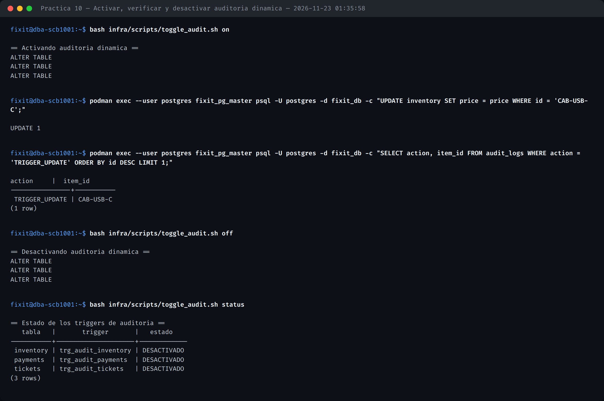
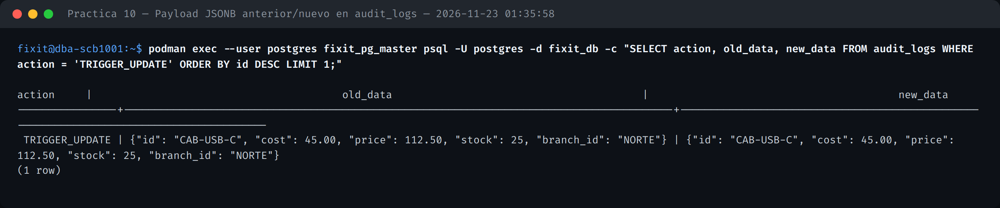
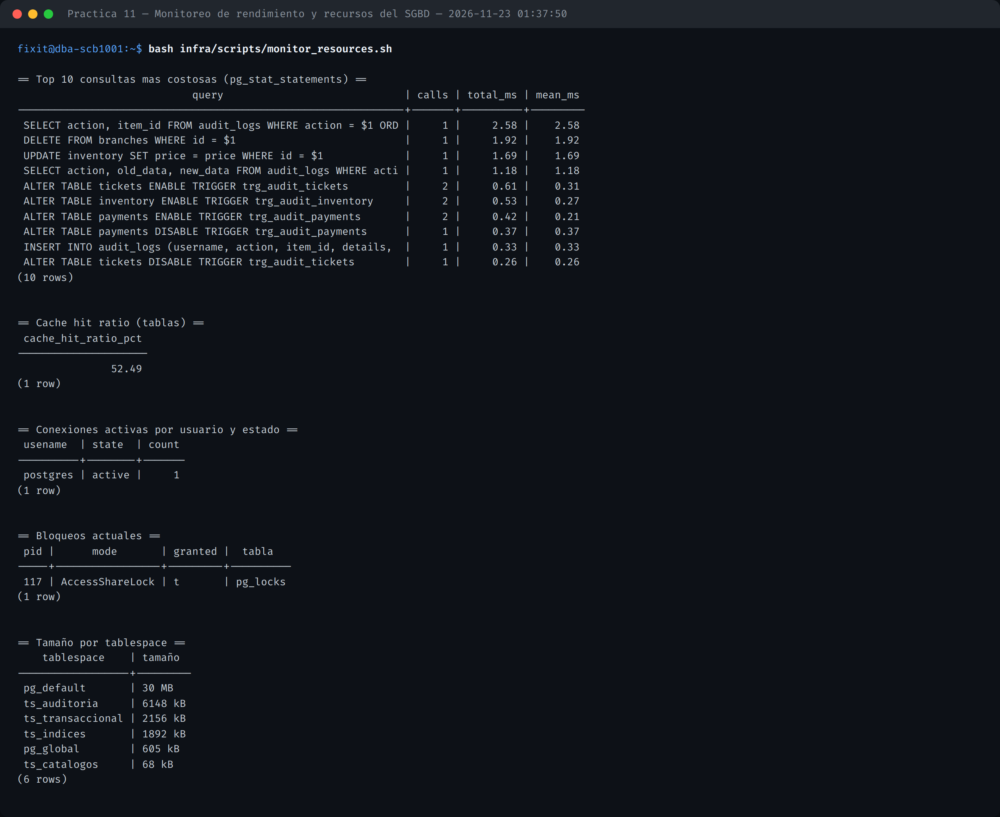
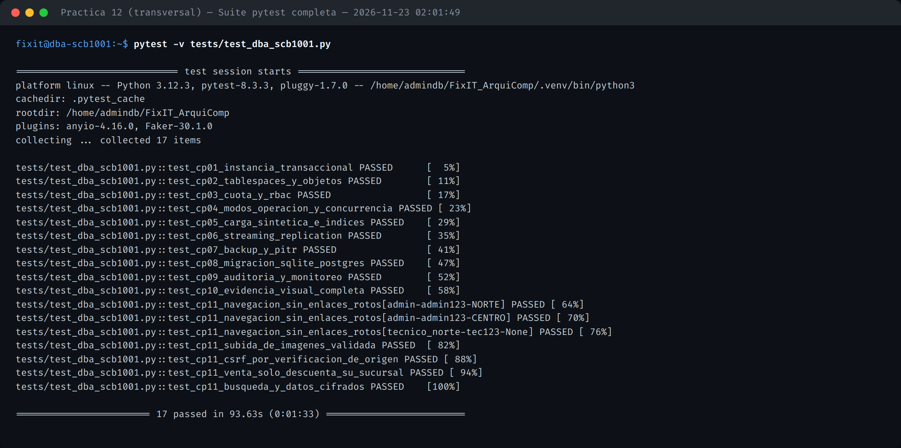
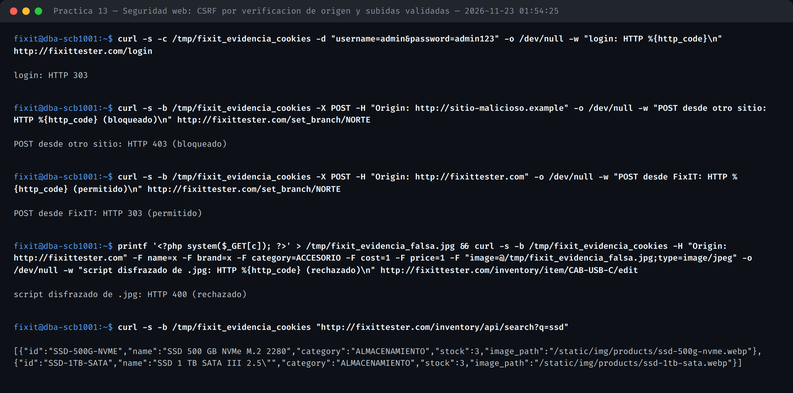
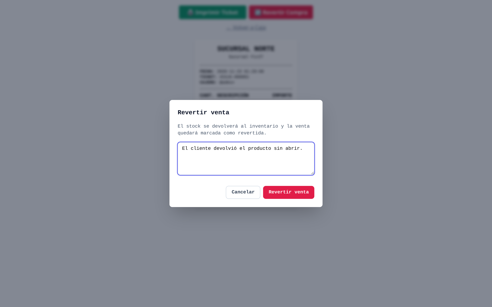
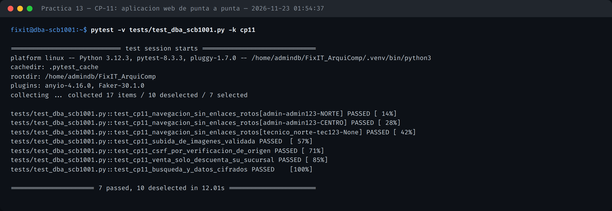

# REPORTE_AUDITORIA.md — SCB-1001

**Unidad 6** (Monitoreo y auditoría) · **Prácticas 10 y 11**

## 1. Auditoría dinámica: activar, verificar y desactivar

`src/sql/05_audit_and_monitoring.sql` define `trg_audit_dml()` (`SECURITY DEFINER`), un trigger genérico adjunto a `payments`, `tickets` e `inventory` que inserta en `audit_logs` con `action = 'TRIGGER_INSERT/UPDATE/DELETE'` y captura la fila anterior/nueva completa. `infra/scripts/toggle_audit.sh [on|off|status]` usa el mecanismo nativo `ALTER TABLE ... ENABLE/DISABLE TRIGGER` de PostgreSQL.



Con la auditoría activa, cada cambio queda registrado; desactivada, los cambios subsecuentes no generan traza — verificado en vivo: el conteo de `TRIGGER_UPDATE` no avanza tras `toggle_audit.sh off`.

## 2. Payload JSONB antes/después

```sql
SELECT action, old_data, new_data FROM audit_logs WHERE action = 'TRIGGER_UPDATE' ORDER BY id DESC LIMIT 1;
```



Vista en la interfaz web (visibilidad exclusiva de ADMIN), combinando las trazas automáticas del trigger con los registros de negocio que la propia app ya insertaba (`VENTA_DIRECTA`, `MERMA`, etc.):


## 3. Monitoreo de rendimiento y recursos del SGBD

`infra/scripts/monitor_resources.sh` reporta, con datos reales: las 10 consultas más costosas (`pg_stat_statements`), el *cache hit ratio*, conexiones activas por usuario/estado, bloqueos (`pg_locks`) y el tamaño por tablespace.



## 4. Suite de validación académica (CP-01 a CP-11)

`tests/test_dba_scb1001.py` valida de extremo a extremo, contra el clúster real y en cada push en GitHub Actions, los 11 casos de prueba que cubren las prácticas oficiales y la aplicación web:

| Caso | Qué valida |
| :---: | :--- |
| CP-01 | Instancia PostgreSQL 16.4 en modo transaccional |
| CP-02 | 4 tablespaces y objetos fuera de `pg_default` |
| CP-03 | Bloqueo por cuota y rechazo de privilegios RBAC |
| CP-04 | Transición recovery/normal y concurrencia sin stock negativo |
| CP-05 | Carga sintética, `REINDEX` e `Index Scan` |
| CP-06 | Streaming Replication y rechazo de escritura en réplica |
| CP-07 | Respaldo y recuperación PITR exacta |
| CP-08 | Migración SQLite → PostgreSQL verificada al 100% |
| CP-09 | Auditoría dinámica y monitoreo de recursos |
| CP-10 | Las 45 imágenes de evidencia existen, son PNG válidos y pesan > 10 KB |
| CP-11 | Aplicación web completa: enlaces, recursos y formularios; subidas maliciosas; CSRF; aislamiento de stock por sucursal; búsqueda y cifrado |



## 5. Seguridad de la aplicación web (Práctica 13)

- **CSRF por verificación de origen:** toda petición que modifica datos y declara `Origin`/`Referer` debe venir del propio sitio; un formulario de otro dominio recibe 403.
- **Subidas validadas:** cada imagen se comprueba (firma, estructura, límite anti *decompression bomb*) y se recodifica a WebP sin metadatos; un script disfrazado de `.jpg` recibe 400 y no se crea nada.
- **Trazabilidad de reversiones:** revertir una venta o un surtido exige un motivo, que queda en `sales.status` y en `audit_logs`.





El caso CP-11 comprueba todo lo anterior levantando la aplicación real:



