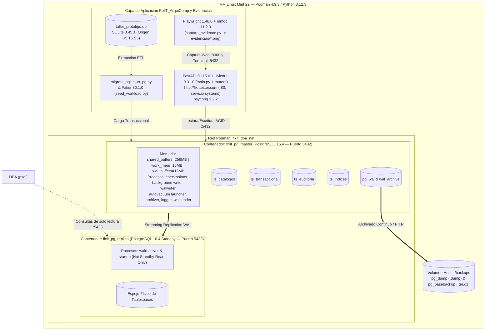
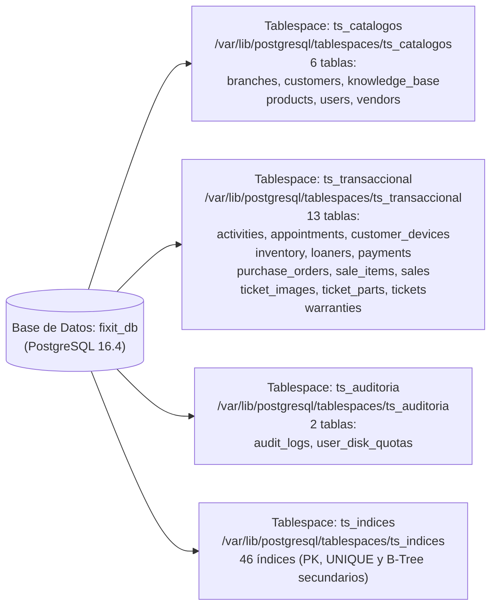
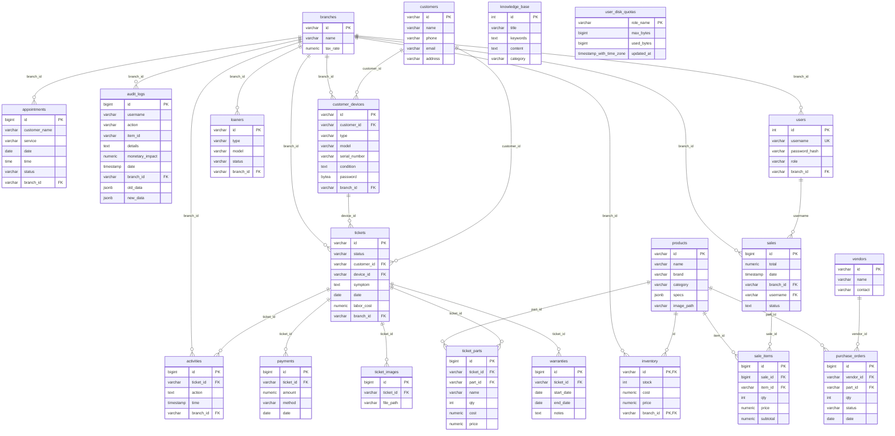
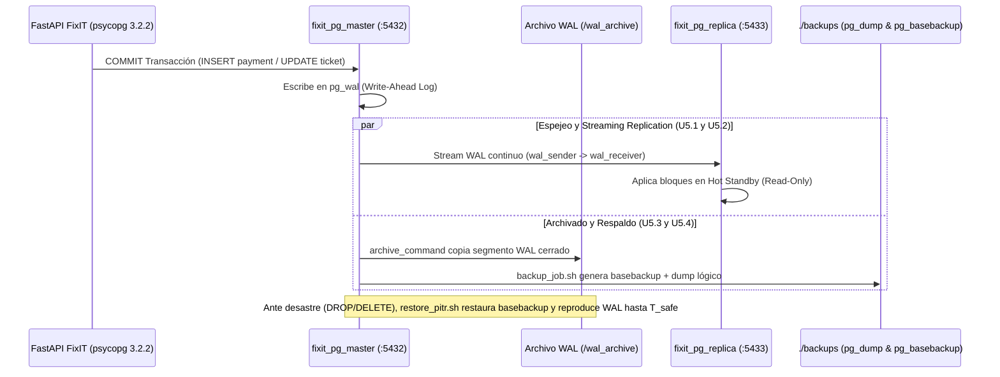

# E06 — Arquitectura del Sistema, Modelo de Datos y Pipeline de Diagramas

## 1. Arquitectura de Memoria, Procesos y Despliegue en Contenedores (`D01_arquitectura_memoria_procesos.png` — Unidad 2)

> *Nota:* Este diagrama se exporta también como archivo independiente `evidencias/diagramas/D01_arquitectura_memoria_procesos.mmd` y se compila a `evidencias/diagramas/D01_arquitectura_memoria_procesos.png` mediante `mmdc`.

## 2. Arquitectura Física de Almacenamiento y Tablespaces (`D02_distribucion_tablespaces.png` — Unidad 3)

> *Nota:* Compilado también en `evidencias/diagramas/D02_distribucion_tablespaces.png`.

## 3. Modelo Relacional Físico Normalizado en 3FN (`D03_modelo_relacional_3fn.png` — Unidad 3)

> *Nota:* Compilado también en `evidencias/diagramas/D03_modelo_relacional_3fn.png`.

## 4. Topología de Espejeo, Réplica, Respaldo y Recuperación PITR (`D04_topologia_replicacion_pitr.png` — Unidad 5)

> *Nota:* Compilado también en `evidencias/diagramas/D04_topologia_replicacion_pitr.png`.

## 5. Política de Seguridad: Roles, Usuarios y Cuotas de Espacio (`U3.T3.S3`, `U3.T3.S5`)

| Rol de Base de Datos | Usuario Login | Privilegios Asignados | Cuota Máxima en Disco (`user_disk_quotas`) | Mecanismo de Control |
| :--- | :--- | :--- | :---: | :--- |
| `rol_dba` | `admin_sys` | `SUPERUSER`, control total de instancia, tablespaces, respaldos y auditoría. | Ilimitada | Control administrativo directo. |
| `rol_tecnico` | `app_tecnico` | `SELECT` en catálogos (`branches`, `customers`, `customer_devices`, `vendors`, `knowledge_base`, `products`, `inventory`, `v_inventory`); `INSERT, UPDATE` en `tickets` y `ticket_parts`; `UPDATE (stock)` en `inventory`. Sin permiso de `DELETE` ni acceso a `payments`. | **50 MB** (`52428800` bytes) | Trigger `trg_enforce_user_quota` aborta inserciones si el espacio atribuido supera `max_bytes`. |
| `rol_recepcion` | `app_recepcion` | `SELECT, INSERT, UPDATE` en `customers`, `customer_devices`, `tickets`; `SELECT, INSERT` en `payments`. Sin permiso de `DELETE`. | **100 MB** (`104857600` bytes) | Mismo trigger `trg_enforce_user_quota` (adjunto a `tickets` y `ticket_parts`); la cuota se descuenta por rol. |
| `rol_auditor` | `app_auditor` | `SELECT` exclusivo sobre `audit_logs`, `pg_stat_statements` y vistas de catálogo (`default_transaction_read_only = on`). | **0 MB** (Solo lectura) | Bloqueo nativo de escritura a nivel de rol. |
| `rol_replicacion` | `replicator` | `REPLICATION LOGIN` para streaming WAL hacia `fixit_pg_replica`. | N/A | Restringido por subred en `pg_hba.conf`. |
