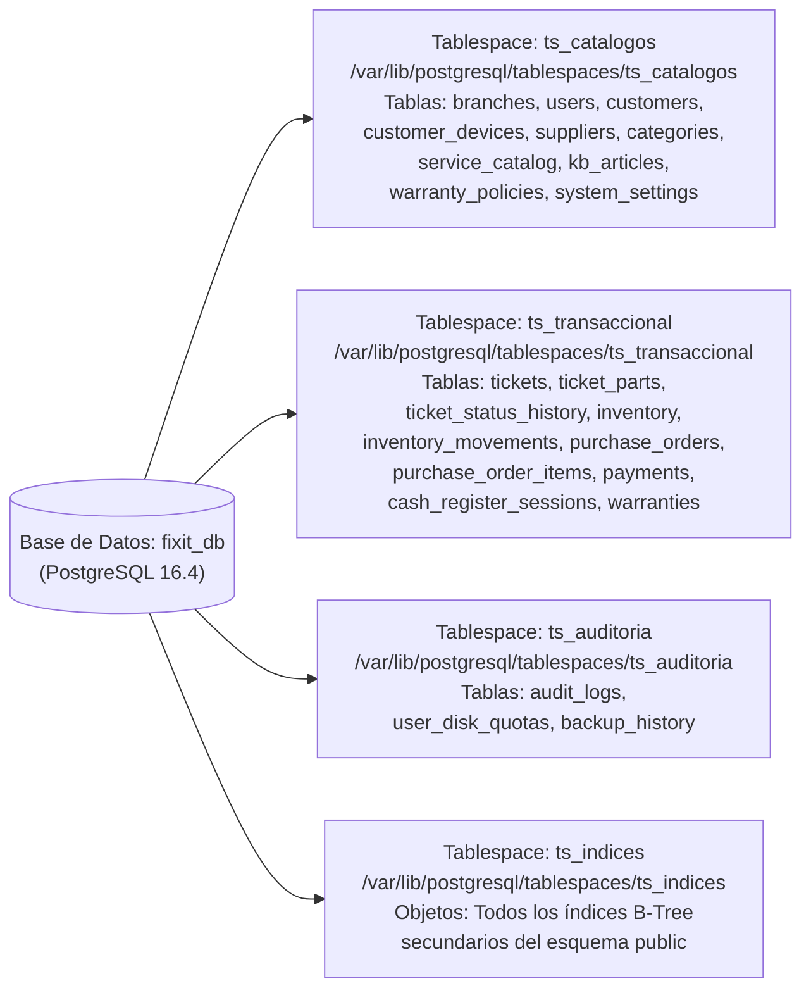
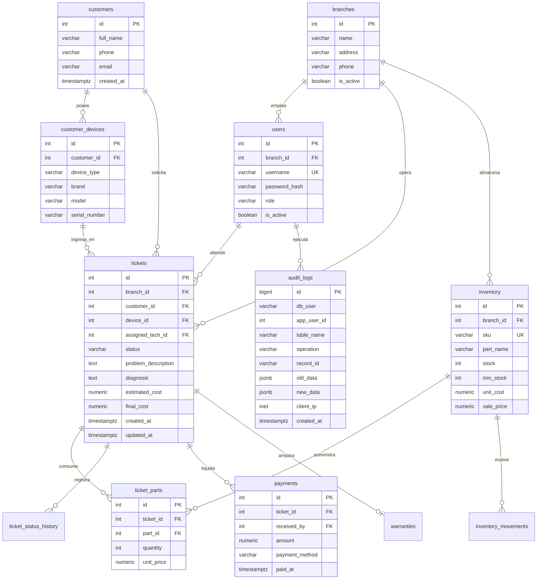
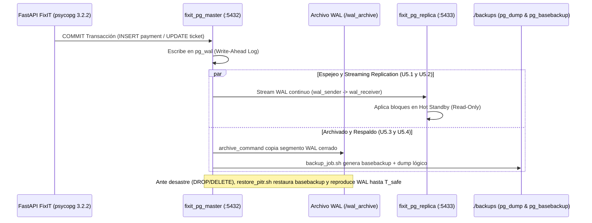

# E06 — Arquitectura del Sistema, Modelo de Datos y Pipeline de Diagramas

## 1. Arquitectura de Memoria, Procesos y Despliegue en Contenedores (`D01_arquitectura_memoria_procesos.png` — Unidad 2)

> *Nota para el Agente:* Este diagrama debe exportarse también como archivo independiente `evidencias/diagramas/D01_arquitectura_memoria_procesos.mmd` y compilarse a `evidencias/diagramas/D01_arquitectura_memoria_procesos.png` mediante `mmdc`[cite: 5, 6].

```mermaid
graph TB
    subgraph VM["VM Linux Mint 22 — Podman 4.9.3 / Python 3.12.3"]
        subgraph AppLayer["Capa de Aplicación FixIT_ArquiComp y Evidencias"]
            FastAPI["FastAPI 0.115.0 (main.py + routers)\nPool psycopg 3.2.2"]
            ETL["migrate_sqlite_to_pg.py\n& Faker 30.1.0 (seed_workload.py)"]
            Capturer["Playwright 1.48.0 + mmdc 11.2.0\n(capture_evidence.py -> evidencias/*.png)"]
            SQLiteDB[("taller_prototipo.db\nSQLite 3.45.1 (Origen U5.T5.S5)")]
        end

        subgraph PodmanNet["Red Podman: fixit_dba_net"]
            subgraph Master["Contenedor: fixit_pg_master (PostgreSQL 16.4 — Puerto 5432)"]
                PGMem["Memoria: shared_buffers=256MB | work_mem=16MB | wal_buffers=16MB\nProcesos: checkpointer, bgwriter, walwriter, autovacuum, stats collector"]
                TS1[("ts_catalogos")]
                TS2[("ts_transaccional")]
                TS3[("ts_auditoria")]
                TS4[("ts_indices")]
                WAL[("pg_wal & wal_archive")]
            end

            subgraph Replica["Contenedor: fixit_pg_replica (PostgreSQL 16.4 Standby — Puerto 5433)"]
                RepProc["Procesos: walreceiver & startup (Hot Standby Read-Only)"]
                RepDisk[("Espejo Físico de Tablespaces")]
            end
        end

        Backups[("Volumen Host: ./backups\npg_dump (.dump) & pg_basebackup (.tar.gz)")]
    end

    SQLiteDB -->|Extracción ETL| ETL
    ETL -->|Carga Transaccional| Master
    FastAPI -->|Lectura/Escritura ACID :5432| Master
    FastAPI -.->|Lectura Reportes :5433| Replica
    Master ==>|Streaming Replication (WAL)| Replica
    WAL ==>|Archivado Continuo / PITR| Backups
    Capturer -.->|Captura Web :8000 y Terminal :5432| FastAPI
```

## 2. Arquitectura Física de Almacenamiento y Tablespaces (`D02_distribucion_tablespaces.png` — Unidad 3)

> *Nota para el Agente:* Exportar y compilar también en `evidencias/diagramas/D02_distribucion_tablespaces.png`[cite: 5, 7].



## 3. Modelo Relacional Físico Normalizado en 3FN (`D03_modelo_relacional_3fn.png` — Unidad 3)

> *Nota para el Agente:* Exportar y compilar también en `evidencias/diagramas/D03_modelo_relacional_3fn.png`[cite: 5, 7].



## 4. Topología de Espejeo, Réplica, Respaldo y Recuperación PITR (`D04_topologia_replicacion_pitr.png` — Unidad 5)

> *Nota para el Agente:* Exportar y compilar también en `evidencias/diagramas/D04_topologia_replicacion_pitr.png`[cite: 5, 8, 9].



## 5. Política de Seguridad: Roles, Usuarios y Cuotas de Espacio (`U3.T3.S3`, `U3.T3.S5`)

| Rol de Base de Datos | Usuario Login | Privilegios Asignados | Cuota Máxima en Disco (`user_disk_quotas`) | Mecanismo de Control |
| :--- | :--- | :--- | :---: | :--- |
| `rol_dba` | `admin_sys` | `SUPERUSER`, control total de instancia, tablespaces, respaldos y auditoría. | Ilimitada | Control administrativo directo[cite: 5, 6]. |
| `rol_tecnico` | `app_tecnico` | `SELECT` en catálogos; `INSERT, UPDATE` en `tickets`, `ticket_parts`, `ticket_status_history`; `UPDATE (stock)` en `inventory`. Sin permiso de `DELETE` ni acceso a `payments`. | **50 MB** (`52428800` bytes) | Trigger `trg_enforce_user_quota` aborta inserciones si el espacio atribuido supera `max_bytes`[cite: 5, 7]. |
| `rol_recepcion` | `app_recepcion` | `SELECT, INSERT, UPDATE` en `customers`, `customer_devices`, `tickets`; `SELECT, INSERT` en `payments`. Sin permiso de `DELETE`. | **100 MB** (`104857600` bytes) | Trigger `trg_enforce_user_quota` activo sobre tablas de recepción y caja[cite: 5, 7]. |
| `rol_auditor` | `app_auditor` | `SELECT` exclusivo sobre `audit_logs`, `pg_stat_statements` y vistas de catálogo (`default_transaction_read_only = on`). | **0 MB** (Solo lectura) | Bloqueo nativo de escritura a nivel de rol[cite: 5, 9]. |
| `rol_replicacion` | `replicator` | `REPLICATION LOGIN` para streaming WAL hacia `fixit_pg_replica`. | N/A | Restringido por subred en `pg_hba.conf`[cite: 5, 8]. |
